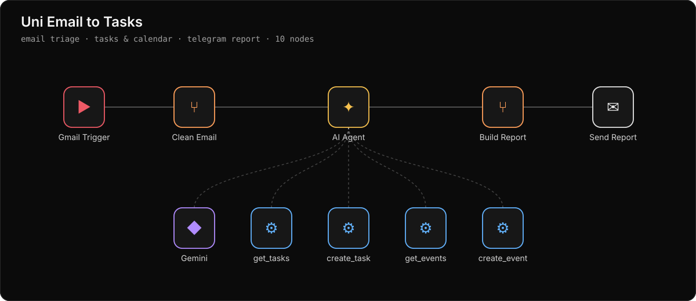
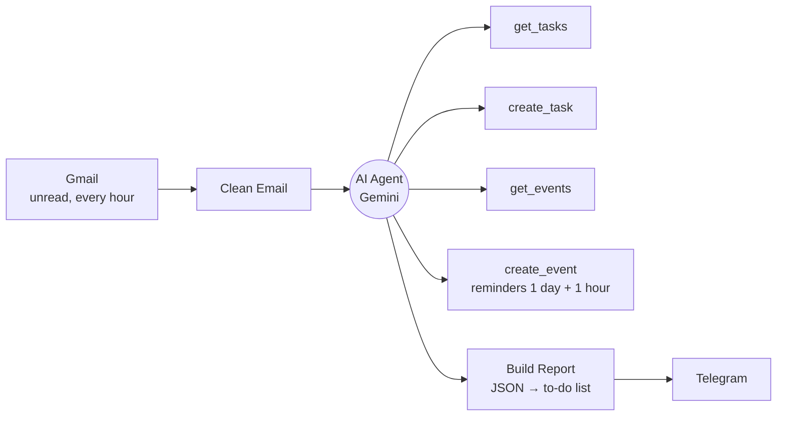

<p align="center"></p>

<p align="center">
  <a href="https://sfditala.github.io/uni-email-to-tasks/"></a>
</p>

> **Built for my own studies.**

Every hour, an agent reads my unread UCAS emails. New lectures become Google Tasks, and assignments and quizzes go on Google Calendar with reminders. Then one tidy report arrives on Telegram, so I don't have to open the inbox.

In the [explorer](https://sfditala.github.io/uni-email-to-tasks/) you can press play and follow an email through the workflow, node by node. Click any of the 10 nodes to read its real prompt, code and connections.

## What happens to each email

These are the kinds of emails I actually get.

| Email | What the agent does |
|---|---|
| 📚 **New lecture** on Moodle | **→ Google Tasks.** A task named after the course and the lecture, due today. |
| 📝 **Assignment + 🧪 quiz** in one email | **→ Tasks + Calendar.** A task for the assignment, the deadline on the calendar, the quiz at its exact time and room, with reminders a day and an hour before. |
| ❓ **Assignment, no deadline** | **→ Task + warning.** It won't invent a date. The report tells me to check Moodle. |
| 🔁 **Same assignment again** | **→ Nothing new.** It searches first, finds it, and creates nothing. |
| 📭 **Not about uni** | **→ Ignored.** One line at the bottom of the report. |

[▶ Try this in the explorer](https://sfditala.github.io/uni-email-to-tasks/)

## The report

One message an hour, only when there's something new. Lines that mix Arabic and English stay aligned to the right, and every item links back to its email.

```text
🎓 تقرير الجامعة
🗓 الأحد 8/11 · 12:10  |  📬 4 إيميلات جديدة
────────────
✅ مهام جديدة (3)
☐ 📚 Chapter 2 numpy part 2 (create ndarray) ↗️
      📘 برمجة للذكاء الاصطناعي  ·  ⏳ اليوم
☐ 📝 Assignment 2 (ER Diagrams) ↗️
      📘 Database Systems  ·  ⏳ الأحد 15/11
────────────
📅 مواعيد انضافت للكلندر (2)
⏰ تسليم: Assignment 2 (ER Diagrams) ↗️
      🕒 الأحد 15/11 · 23:59  ·  📘 Database Systems
🧪 Quiz 1 ↗️
      🕒 الثلاثاء 10/11 · 10:00  ·  📍 B204  ·  📘 Database Systems
────────────
⚠️ بدها انتباهك
❗ الايميل ما فيه ديدلاين لـ Assignment 3 — شوفيه عالمودل ↗️
────────────
🔁 موجودة من قبل (ما كررتها)
📚 Lecture 5 slides (شبكات الحاسوب)
────────────
📭 إيميلات مش دراسية (1)
▫️ Get off to a flying start
```

## The workflow

<a href="https://sfditala.github.io/uni-email-to-tasks/"></a>



## The problem

Moodle and university emails don't notify me unless I open the inbox. Lectures, assignments and quizzes get buried under 70+ unread emails, deadlines slip past, and I can't easily tell what's piling up and what I've already finished.

## How it was built

**Stack:** n8n · Google Gemini (free tier) · Gmail · Google Tasks · Google Calendar · Telegram Bot API

<details open>
<summary><b>Design decisions</b></summary>

- **One agent, no sub-agents.** n8n already runs the agent once per email, and one agent can call several tools for a single email. Sub-agents would only double the model calls.
- **Search before creating.** The agent checks Google Tasks and the calendar first. A reminder email or a repeated announcement doesn't create a second copy.
- **Never guess a date.** If an email has no clear deadline or time, nothing goes on the calendar. The report flags it so I check Moodle myself.
- **The model decides, the code formats.** The agent returns plain JSON about what it did. A Code node turns that into the Telegram report, so the layout is the same every time.
- **Built to run free.** Gemini's free tier allows 5 requests a minute. The agent handles one email at a time, waits between emails and retries on failure.

</details>

<details>
<summary><b>What broke, and the fix</b></summary>

| What went wrong | The fix |
|---|---|
| The agent was reading empty emails: every subject came through as "(no subject)". | Gmail Trigger's Simplify mode drops the body and capitalises field names. I turned it off, and the clean-up step now reads both formats. |
| Task and event fields were fixed values, so every event landed on the current time. | Every field is now filled by the model through `$fromAI`, with a clear description for each one. |
| Three emails at once hit `429 Too Many Requests` on the free tier. | Batching of one email at a time, a 45-second gap and automatic retries. |
| A 23:59 deadline showed as 23:29 in the report, because the event ended at the deadline. | Deadline events now start at the deadline, so the reminder a day before is exact too. |
| Lines that mixed Arabic and English course names lined up on the wrong side in Telegram. | Every line starts with a right-to-left mark. |
| Gaza switches between UTC+2 and UTC+3. | The prompt gets the current offset at run time instead of a hard-coded one. |

</details>

## Run it yourself

1. In n8n, go to **Workflows → Import from File** and choose [`workflow.json`](workflow.json).
2. Connect Gmail, Google Gemini, Google Tasks, Google Calendar and Telegram credentials.
3. Replace `YOUR_GOOGLE_TASKLIST_ID`, `YOUR_CALENDAR_ID` and `YOUR_TELEGRAM_CHAT_ID`.
4. Set the workflow timezone to yours, and change the university name and timezone at the top of the agent's prompt.
5. Message your Telegram bot once with `/start` so it's allowed to message you, then publish.

This export contains no credentials or webhook IDs. Personal IDs are replaced with placeholders, and [a check](scripts/check-clean.mjs) runs on every push.

## العربية

<div dir="rtl">

إيجنت بيفحص إيميلي الجامعي كل ساعة: المحاضرات الجديدة بتنضاف على Google Tasks، والاسايمنتات والكويزات بتنحط على الكلندر مع تذكير، وبيوصلني تقرير مرتب على تيليجرام بدل ما أفتح الإيميل وأدور.

</div>

---

<p align="center">Built by <a href="https://portfolio-mauve-seven-44.vercel.app/"><b>Tala Safadi</b></a>, AI Engineer · <a href="https://www.linkedin.com/in/talasfdi">LinkedIn</a><br>More systems: <a href="https://github.com/Sfditala/telegram-personal-assistant">Telegram Personal Assistant</a> · <a href="https://github.com/Sfditala/clinic-ai-receptionist">Clinic AI Receptionist</a> · <a href="https://github.com/Sfditala/ai-marketing-team">AI Marketing Team</a></p>
